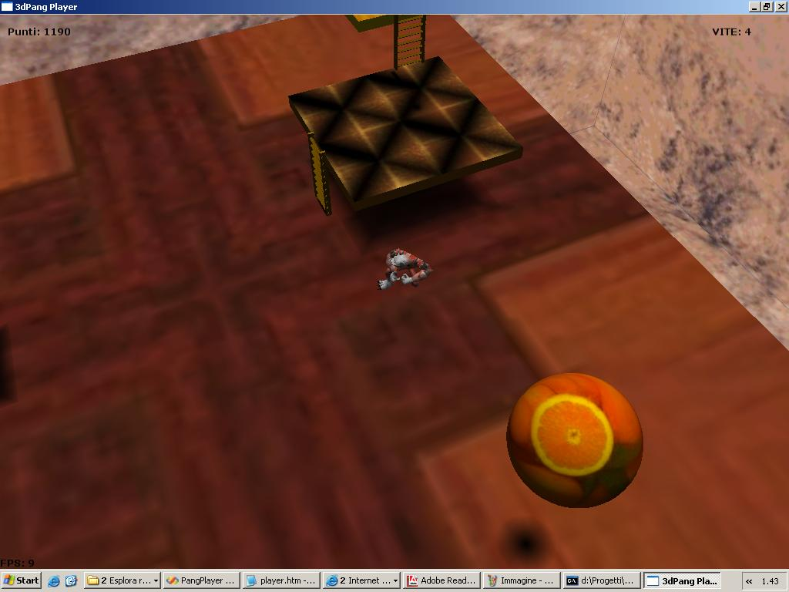
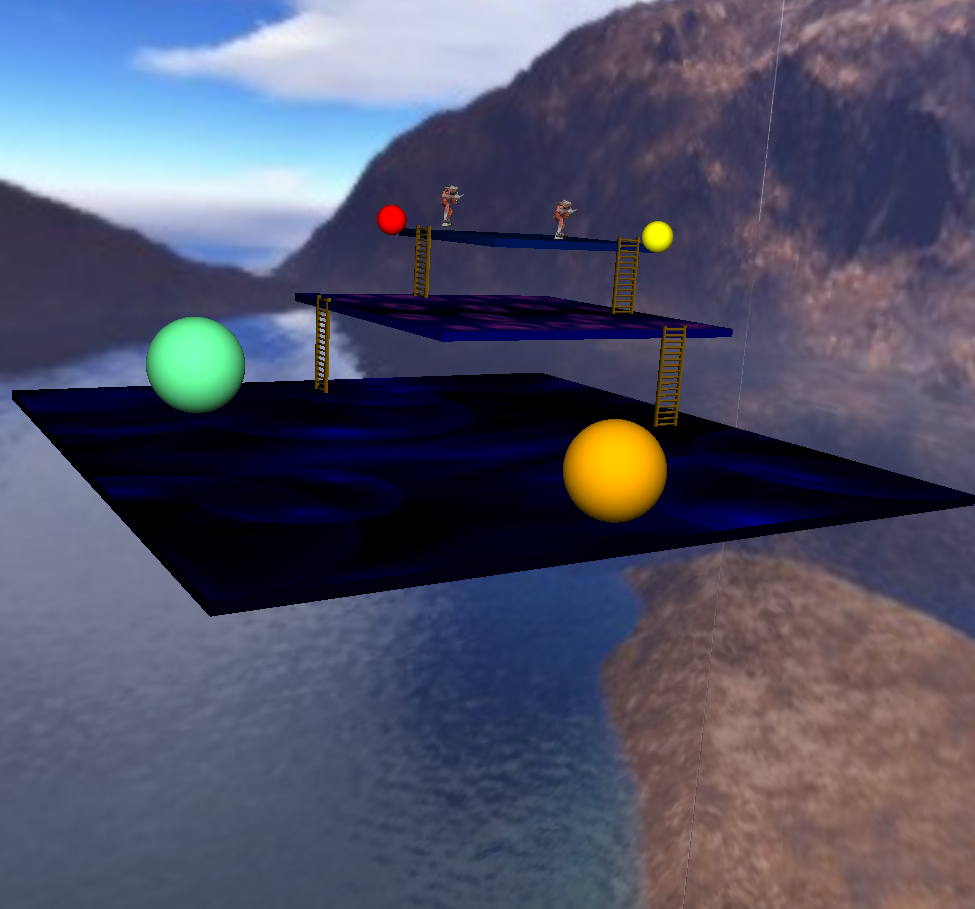
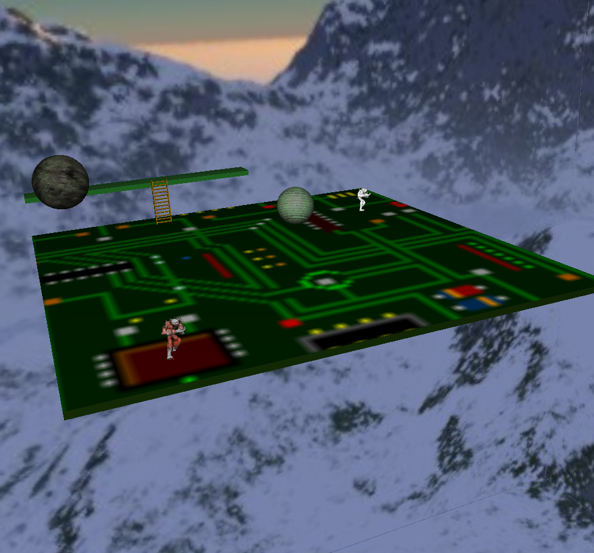
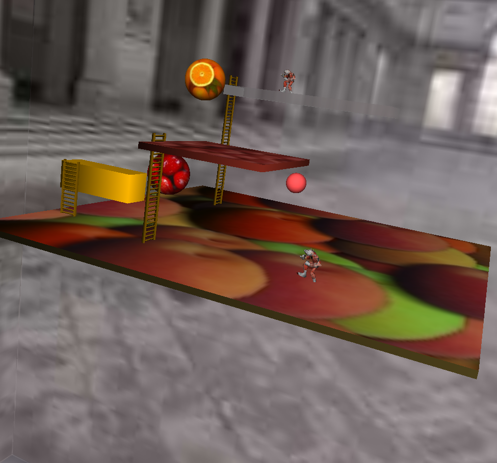
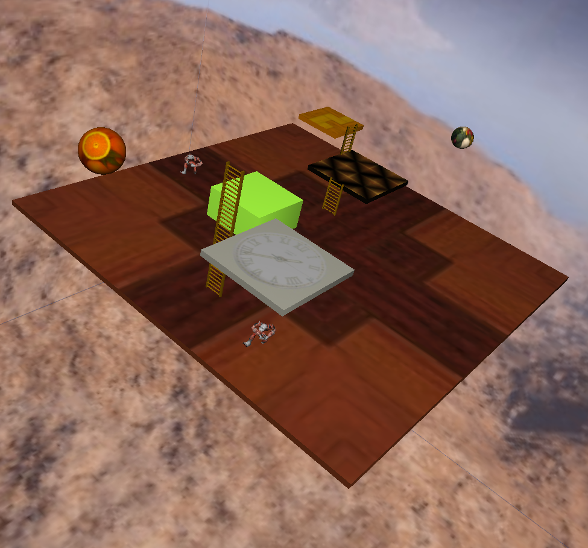

# 3dPang

[](https://github.com/andrealorenzani/3dPang/actions/workflows/build.yml)


-yellowgreen)


[](LICENSE)

A 3D game inspired by *Pang* (Mitchell, 1989), with its own level editor.

Balls bounce around the player, and every ball you hit splits into smaller ones until they pop.
You fight them with harpoons, a quadruple harpoon and a gun, across floors, walls and ladders.
Popped balls drop bonuses (fruit, extra lives, weapons) and maluses (tornadoes, blinding bombs).
One or two players (split screen), five difficulty levels, three detail levels.



| | |
|---|---|
|  |  |
|  |  |

*(Screenshots from 2005. The game looks the same today.)*

## Contents
[History](#history-of-the-project) ·
[Install as a user](#install-as-a-user) · [How to play](#how-to-play) ·
[Import as a developer](#import-as-a-developer) · [Libraries](#libraries-and-versions) ·
[Documentation](#documentation) · [Agentic workflow](#agentic-workflow) ·
[Thanks](#thanks-and-credits) · [Licence](#licence)

## History of the project

3dPang started in the academic year 2003/2004 as the exam project of the course
***Costruzione di Interfacce*** (*Interface Construction*, computer science, University of Pisa),
taught by **Paolo Cignoni** of ISTI-CNR. **Andrea Lorenzani** and **Eva Tamburini** wrote it together as students. The code, comments and
documentation were in Italian (at that point the English of the two developers was not good enough for
anything else).

The assignment was to build an interactive 3D application with a real interface. They built
**two programs**: the *Player*, the game itself, and the *Editor*, to make levels, in C++ with
OpenGL, with **Qt 3.2** for the windows, **SDL** for the game loop, **GLEW**, the **BMF-Font**
bitmap font library, the Quake II **MD2** player models and a handful of 3D Studio models. The course's
own graphics library (the ancestor of today's [vcglib](https://github.com/cnr-isti-vclab/vcglib))
supplied the maths, the sky box, the MD2 loader and the trackball. The IDE was Visual Studio .NET 2003.

The result was published on 21 March 2005 as **3dPang 1.0b** on the web page *"-Il Maestro- presenta:
3dPang"* (info, screenshots, download, known bugs and greetings sections; 1,810 visitors counted).
It is still on the Wayback Machine:
<https://web.archive.org/web/20050623004727/http://www.supermaestro.org/download/3dPang/>.
The page carries the line *"3dPang - (c) Andrea Lorenzani & Eva Tamburini 2004-2005"*.

Andrea later put the code on GitHub, to avoid losing it and to be able to study it again. In **2026**
it became **version 2.0**: ported to Qt 6, SDL3, the current vcglib and CMake; translated into English
(code, comments, interface and documentation); cleaned of its build leftovers; and given tests and CI.
The game itself, its levels and its look are unchanged. See [CHANGELOG.md](CHANGELOG.md) for everything
that changed, including the 2005 bugs found along the way.

**The 2005 version is preserved**, exactly as it was, in the tag and the branch `original_with_Eva`
(Eva is in the name on purpose):

```sh
git switch original_with_Eva                 # the branch
git checkout refs/tags/original_with_Eva     # the tag, as a detached snapshot
```

(Both have the same name, so `git checkout original_with_Eva` is ambiguous: use one of the lines above.)

## Install as a user

**Release packages** (recommended; available from the 2.0 release): download the archive for your system from the
[Releases page](https://github.com/andrealorenzani/3dPang/releases), unpack it and run
`bin/3dpang` (the game) or `bin/3dpang-editor`.

| System | Package | Needs |
|---|---|---|
| Windows 10/11 x64 | `3dPang-vX.Y-windows-x64.zip` | nothing else (Qt and SDL are in the zip) |
| Linux x64 | `3dPang-vX.Y-linux-x64.tar.gz` | Qt 6 libraries (`qt6-base`), an OpenGL driver; SDL3 is in the archive |
| macOS | build from source | see below |

**From source** (any system): install CMake ≥ 3.21, a C++17 compiler and Qt 6, then

```sh
git clone https://github.com/andrealorenzani/3dPang.git && cd 3dPang
cmake -S . -B build -DCMAKE_PREFIX_PATH=/path/to/Qt/6.x/<kit>
cmake --build build --parallel
./build/3dpang
```

SDL3 and vcglib are downloaded automatically. Per-platform packages and options:
[docs/BUILDING.md](docs/BUILDING.md).

## How to play

Run `3dpang`. Move in the menu with the arrows, confirm with **Enter**, go back with **Esc**; choose
*New Game* and the number of players. A campaign (*classic*) is already selected.

| Action | Player 1 | Player 2 |
|---|---|---|
| Move | arrow keys | W A S D |
| Fire | M | Q |
| Climb up / down a ladder | J / N | R / F |
| Fixed view | F2 | F9 |
| Views following the player | F3, F4, F5 | F6, F7, F8 |

Clear a level by popping every ball. Avoid being touched; pick up bonuses, avoid maluses
(tornado, bomb). Rules, power-ups and difficulty: [docs/PLAYER.md](docs/PLAYER.md) and
[docs/product.md](docs/product.md). To make your own levels run `3dpang-editor`
([docs/EDITOR.md](docs/EDITOR.md)).

## Import as a developer

```sh
git clone https://github.com/andrealorenzani/3dPang.git
export QT_DIR=$HOME/Qt/6.8.3/gcc_64            # your Qt 6 installation
cmake --preset release && cmake --build --preset release
ctest --preset release                         # 13 tests
```

* **CLion**: *File → Open* the folder, enable the `debug` preset profile in *Settings → Build → CMake*,
  add `QT_DIR` to the profile environment. Targets `3dpang`, `3dpang-editor`, `3dpang-tests`.
* **Visual Studio 2022**: *File → Open → Folder*; **Qt Creator**: open `CMakeLists.txt` with a Qt 6 kit;
  **VS Code**: CMake Tools with the presets.
* Start with [docs/developer_manual.md](docs/developer_manual.md), then
  [docs/architecture.md](docs/architecture.md) and [docs/code.md](docs/code.md).

```
src/common src/course src/scenegraph   shared engine (built twice: player and editor)
src/player                             SDL3 game: window, menu, keyboard
src/editor                             Qt 6 editor
data/                                  levels, campaigns, textures, sky boxes, models, fonts
tests/ tools/ docs/ .claude/           tests, scripts, documentation, agentic workflow
```

## Libraries and versions

| Library | Version | Used for | Licence |
|---|---|---|---|
| **C++** | 17 | language | |
| **Qt** | 6.8.3 (minimum 6.4) | images, XML, the editor's GUI and OpenGL widget | LGPL v3 / GPL |
| **SDL** | 3.4.20 | the game's window, OpenGL context, keyboard | zlib |
| **vcglib** | 2025.07 | points, matrices, OpenGL wrappers | GPL v3 |
| **Eigen** | 3.4.0 (bundled with vcglib) | linear algebra used by vcglib | MPL 2 |
| **OpenGL** | 1.3+ compatibility profile (2.1 requested) | rendering (fixed-function pipeline) | |
| **CMake** | ≥ 3.21 | build system | |
| **BMF_font** | 1.01 (2003), included | bitmap font rendering | LGPL v2.1+ |
| Course library | 2002-2004, included in `src/course` | sky box, MD2 models, trackball | see headers |
| GitHub Actions, CTest, gcov | | CI, tests, coverage | |

Not used any more (2005): Qt 3.2, SDL 1.2, GLEW, GLU, lib3ds 1.2, Visual Studio .NET 2003.

## Documentation

| Document | For |
|---|---|
| [docs/product.md](docs/product.md) | what the game is: rules, bonuses, malus, power-ups, difficulty, content |
| [docs/architecture.md](docs/architecture.md) | libraries, engine, scene graph, rendering, build, decisions |
| [docs/code.md](docs/code.md) | file map, classes, patterns, conventions, recipes, pitfalls |
| [docs/developer_manual.md](docs/developer_manual.md) | install, use, change, release |
| [docs/quality_assurance.md](docs/quality_assurance.md) | tests, coverage, gaps, checklists |
| [docs/PLAYER.md](docs/PLAYER.md), [docs/EDITOR.md](docs/EDITOR.md) | player and editor guides |
| [docs/LEVEL_FORMAT.md](docs/LEVEL_FORMAT.md) | level and campaign files |
| [docs/BUILDING.md](docs/BUILDING.md) | build details for every platform |

## Agentic workflow

The repository includes a [Claude Code](https://claude.com/claude-code) workflow for making changes.
`/new_feature <description>` runs an **analyser** (plans against `docs/`), a **coder**, a **qa** agent and a
**documenter** (cheap model, updates `docs/`). See [docs/developer_manual.md](docs/developer_manual.md#5-agentic-workflow).

## Thanks and credits

* **Eva Tamburini**, co-author of the original game: her name is in the history of this repository on purpose.
* **Paolo Cignoni** (ISTI-CNR Pisa), teacher of *Costruzione di Interfacce*: the course library
  (cube map, MD2 loader) and the project assignment; and, with the **Visual Computing Lab**, **vcglib**.
* **Claudio Rocchini** (ISTI-CNR), trackball code.
* **Markus Trenkwalder**, BMF_font, the OpenGL bitmap font library (LGPL).
* Player models, Quake II fan models (their `readme.txt` is next to each):
  **Wetflame Gyrochaos**, *Little Buu*; **Hunter** (model), **Burnt Kona** (mapping), **Fafner**
  (animations) and **Deranged** (skin), *Hobgoblin*.
* The **Qt**, **SDL** (libsdl.org), **Eigen**, **GLEW** and **lib3ds** projects and communities, whose
  libraries made 2005 possible and today possible again.
* **id Software**, for the MD2 format; **Mitchell Corporation**, for *Pang*.
* The authors and sites of the textures, sky boxes and 3D Studio models that were gathered for the 2005
  game (their "Greetings" page is not preserved, and the origin of each file is not documented: if
  you recognise one, please open an issue so it can be credited).
* The visitors of the original page, and everyone who played it.
* The 2.0 port, documentation and workflow were prepared with **Claude Code** (Anthropic).

*Pang* is © Mitchell Corporation, 1989. 3dPang is an independent student project, not affiliated with
or endorsed by Mitchell.

## Licence

Code: [GNU General Public Licence v3](LICENSE), © 2004-2026 Andrea Lorenzani and Eva Tamburini.
Third-party parts keep their own licences (table above, file headers, and the `readme.txt` next to the models).
