# 3dPang editor guide

*The screenshots are from the 2005 version (Qt 3, Italian interface). Version 2
has the same tabs, dialogs and tools, in English.*

## Main floor

When it starts (and on *File → New*), the editor asks for the size of the
**main floor**: cells along X and Z (5 units each) and thickness. The main
floor is surrounded by four invisible walls, and the two players start in
its middle. It cannot be moved or deleted.

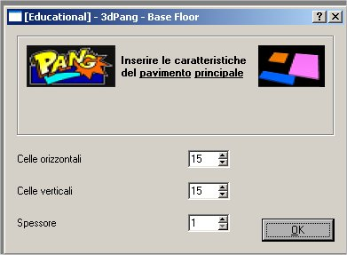 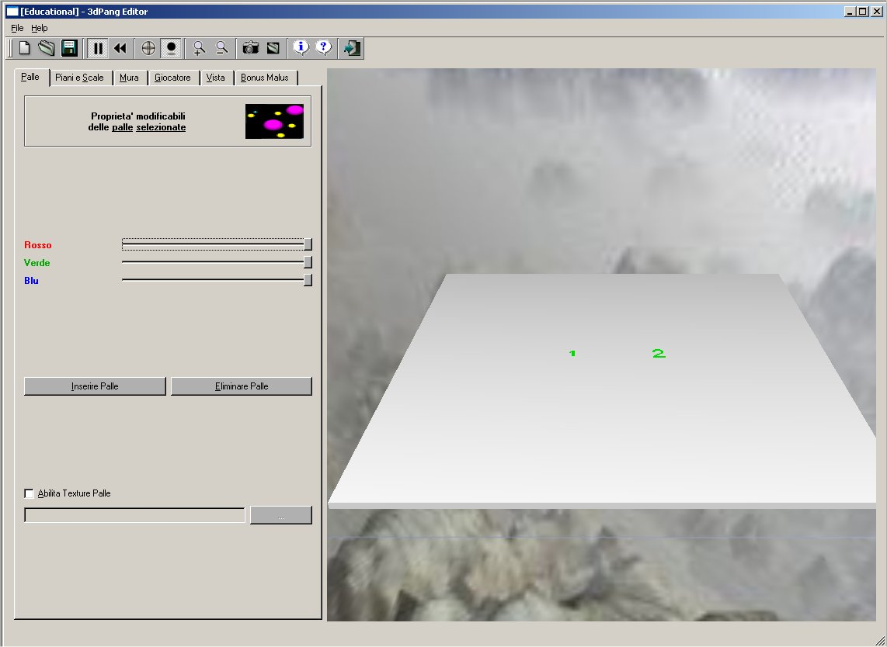

Then build the level, or open an existing one (*File → Open*, or
`3dpang-editor LEVEL.xml`). On the left are the tabs to create and change
objects, on the right the 3D view of the level.

## Toolbar, editing views and background

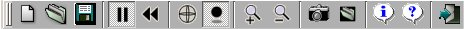

| | |
|---|---|
|  | new level |
| 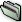 | open a level |
|  | save the level |
|  | pause / play the animation (balls bounce while playing) |
|  | put the balls back at their start position |
|  | trackball mode: the mouse rotates the view |
|  | show shadows |
| 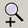 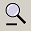 | zoom in / out |
| 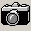 | snapshot of the view (saved in your Pictures folder) |
| 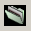 | background image (sky box): pick any face, e.g. `mount_posx.jpg` |
|  | about |
|  | this guide |
|  | quit |

*File → Add to Campaign* appends the current level to a campaign (a new one
is created if the file does not exist). Levels must be saved in
`data/levels` to be used in campaigns.

**Double click** anywhere, in both selection and trackball mode, to centre
the view on that point.

## Balls: add, change, delete

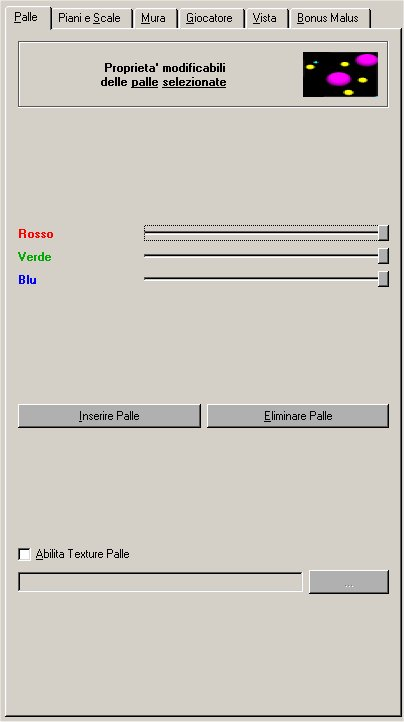 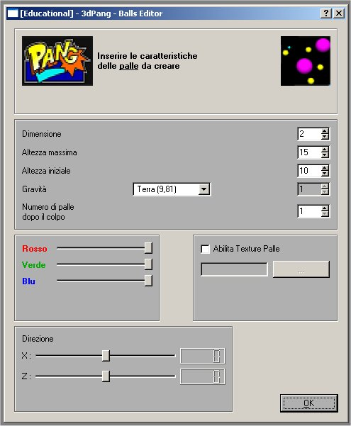

To create balls on top of some floor cells:

1. make sure trackball mode is off;
2. click the cells (they turn pink);
3. press **Add balls...** and set size, maximum and start height, gravity
   (Earth, Moon, Jupiter, Mars, Pluto or custom), how many balls each one
   splits into, colour, texture and direction.

To change balls, select them (they become half transparent), then:

* change colour and texture in the *Balls* tab;
* drag them with the mouse;
* press **Delete balls**.

## Floors: add, change, delete

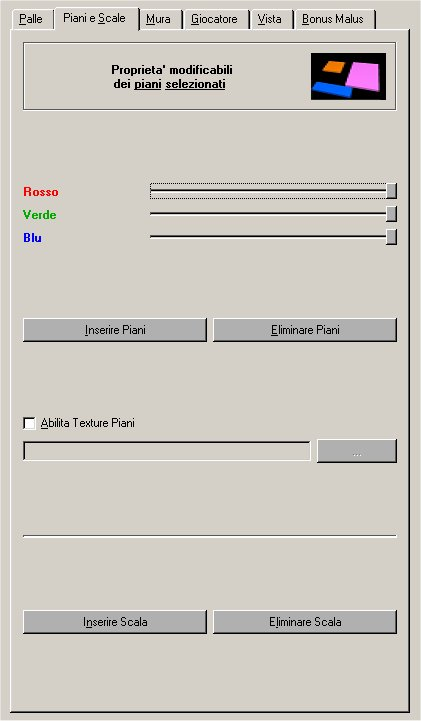 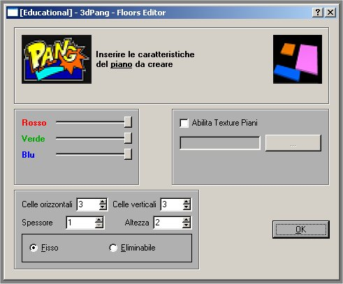

Press **Add floor...** and set size, thickness, height, colour, texture and
whether the floor is *fixed* or *destructible* (destroyed when hit by a shot,
and drawn half transparent).

To change floors (trackball mode off), select them by clicking one of their
cells, then:

* change colour and texture in the *Floors* tab;
* drag them with the mouse;
* raise or lower them with the mouse wheel;
* press **Delete floors**.

## Ladders: add, change, delete

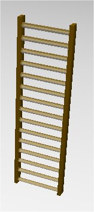

In the *Floors* tab, press **Add ladder** and click where it goes.

To change a ladder (trackball mode off), select it, then:

* drag it with the mouse;
* change the number of rungs with the mouse wheel;
* turn it by 90 degrees with the right mouse button;
* press **Delete ladders**.

## Walls: add, change, delete

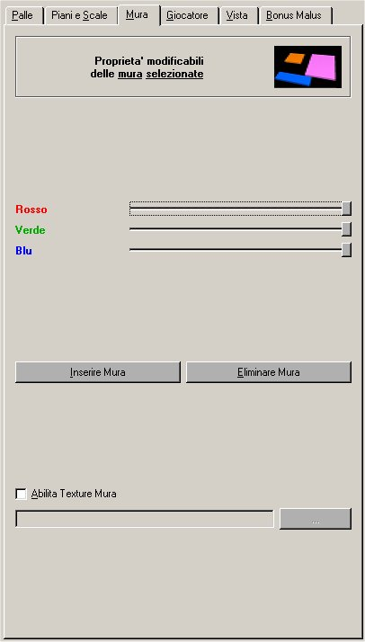 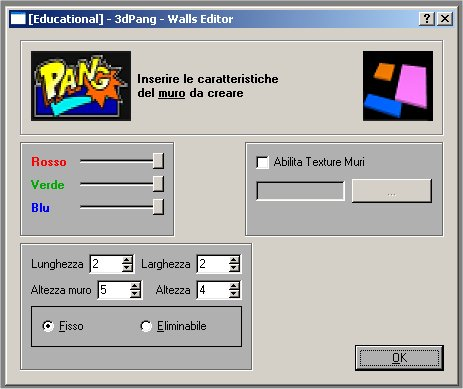

Press **Add wall...** and set length, width, height, elevation, colour,
texture and whether it is fixed or destructible. Walls are changed like
floors.

## Players

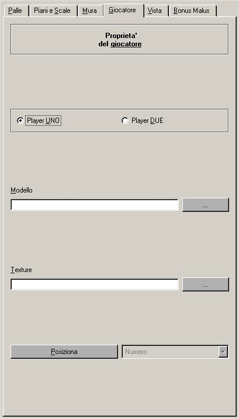

The *Players* tab sets model, skin and start position of both players. The
default model is *Little Buu*; *Hobgoblin* is in `data/models/md2/hobgoblin`.
Choosing a model also picks the first skin found next to it.

To place a player:

1. choose what to show in the view, the **number** or the **model**;
2. press **Place**;
3. click on the start position.

## Game views (F3-F8)

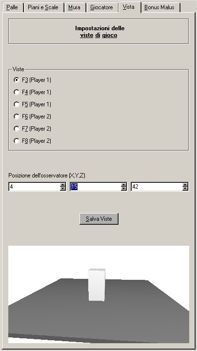

During a game, F3, F4 and F5 switch player 1 to a camera following them,
and F6, F7 and F8 do the same for player 2 (F2 and F9 go back to the fixed
view). In the *Views* tab, choose a key and the position of the camera
relative to the player (X, Y, Z). The small preview shows a box standing in
for the player. Press **Save view** to keep it.

## Power-ups: how often they appear

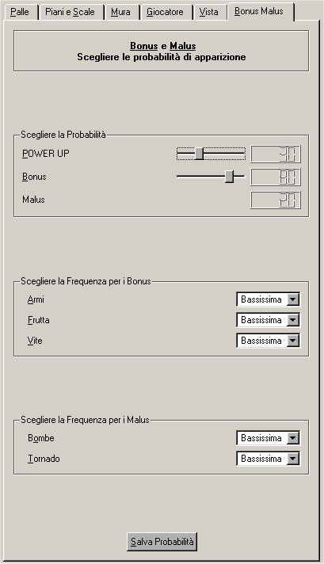

* **Power-up**: the probability that a popped ball drops a power-up.
* **Bonus**: the share of bonuses among them (the rest are maluses).
* The frequency of each bonus (weapons, fruit, lives) and malus (bombs,
  tornado), from *very low* to *very high*.

Press **Save probabilities** to apply them to the level.

## Mouse

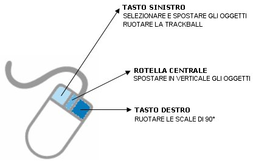

The mouse works in **selection** mode (to select scene objects) or in
**trackball** mode (to rotate the view). In both modes, a double click
changes the centre of the view.

With one or more objects selected:

* drag with the left button to move them on X and Z;
* use the wheel to move them on Y.

Ladders are special:

* the right button turns the selected ladders by 90 degrees on the XZ plane;
* the wheel changes their number of rungs.
