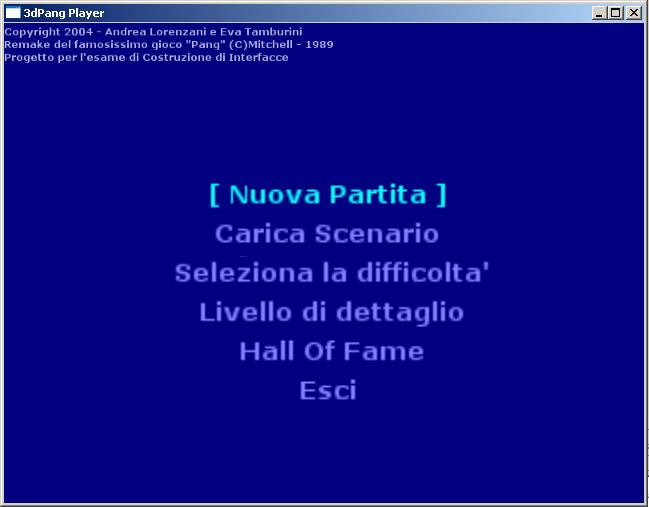
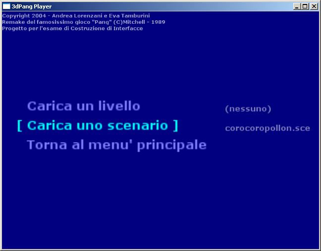
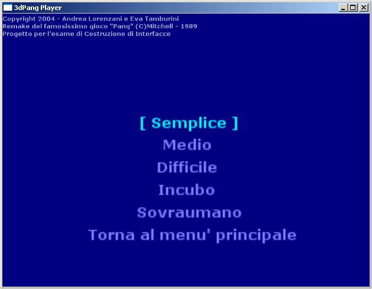
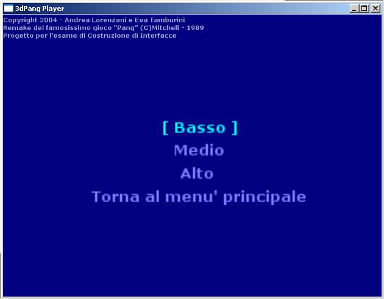
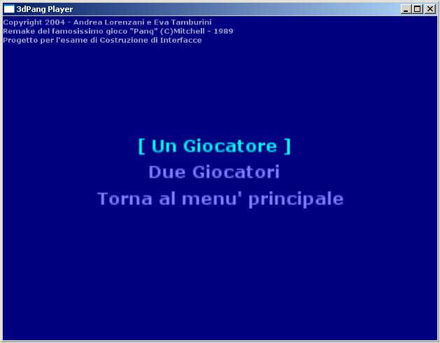
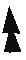
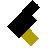
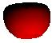
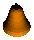

# 3dPang player guide

*The screenshots are from the 2005 version, which had an Italian interface.*

## Main menu

Move with the **up/down arrows**, confirm with **Enter**, go back with **Esc**.

* **New Game**: starts a game, after choosing the number of players. At least
  one level (or campaign) must be selected: the *classic* campaign is
  selected at start-up.
* **Choose Level or Campaign**: a single level, or a campaign (a sequence of
  levels to play from the first to the last).
* **Difficulty**: five levels, from *Easy* to *Superhuman*.
* **Detail**: graphic detail, *Low*, *Medium* or *High*.
* **Hall of Fame**: the ten best scores.
* **Quit**.

To start a game, follow these four steps.

### 1. Choose a level or a campaign

Choose *Load a level* or *Load a campaign*: a list of the levels in
`data/levels` (or campaigns in `data/campaigns`) appears. Pick one with the
arrows and confirm with Enter. The name of the selected level or campaign is
shown under the entry. Selecting a level clears the campaign and the other
way round.

A campaign is a list of levels. You win once you have cleared all of them.

### 2. Difficulty

Difficulty grows quickly from one level to the next. As it rises:

* at *Easy* and *Medium* you can keep shooting even when dead (:p);
* shots last less;
* every ball is worth fewer points;
* power-ups stay on the ground for less time;
* balls are faster and gravity is stronger;
* every ball you hit splits into more balls;
* players run and climb ladders more slowly, and have fewer lives;
* maluses (the bomb flash) last longer and tornadoes are stronger;
* at *Superhuman* balls cast no shadow, so it is much harder to aim.

### 3. Detail

With less detail:

* shots are drawn with fewer polygons;
* there are no textures (*Low*);
* there are no shadows (*Low*), and ball shadows are simpler;
* the sky box is only drawn at *High*;
* tornadoes are made of fewer particles;
* balls have fewer polygons.

In 2005 detail also reduced the frame rate, to help slow computers; version 2
always runs at the refresh rate of the screen.

### 4. Number of players

3dPang can be played alone or by two players together, cooperatively... more
or less! With two players the window is split in two: player 1 plays in the
top half, player 2 in the bottom half. Both play the same level at the same
time and must clear it together.

| Command | Player 1 | Player 2 |
|---|---|---|
| Move up (away) | Up | W |
| Move down (towards) | Down | S |
| Move left | Left | A |
| Move right | Right | D |
| Fire | M | Q |
| Climb a ladder up | J | R |
| Climb a ladder down | N | F |
| Fixed view of the whole level | F2 | F9 |
| Views following the player | F3, F4, F5 | F6, F7, F8 |

The views following the players are set in the editor (see
[EDITOR.md](EDITOR.md#game-views-f3f8)). **Esc** ends the game.

## Bonuses and maluses

When a ball pops it may drop a power-up. Pick it up by walking on it before
it disappears (it blinks during its last five seconds).

Bonuses:

* **Weapons** change the weapon of the player, or give one more shot in play
  if it is the same weapon:
  *  **harpoon**, the
    starting weapon;
  * **quadruple harpoon**, four harpoons that hit much more easily;
  *  **gun**, fast shots,
    five of them in play at the same time (three more each time you pick
    it up again).
* **Fruit** only gives points: 
  apple, banana,  pear,
  in increasing order of points.
* **Heart**: one more life, the most precious bonus.

Maluses:

* **Tornado**: it gathers the balls in one place and drags the players along,
  spinning them around the level.
* **Bomb**: its explosion hits every ball, but first it blinds the players,
  then they see red for a few seconds.

## Scores

Hitting a ball gives points according to its size and the difficulty.
Power-ups give points too, and when you win a campaign every life left is
worth a bonus. The best ten scores are kept in the Hall of Fame.
